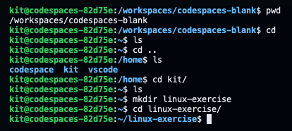
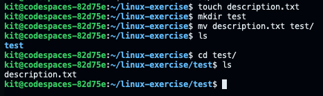
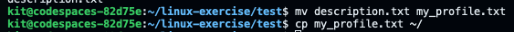
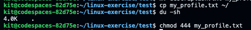
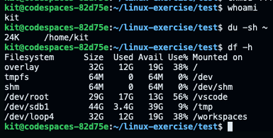
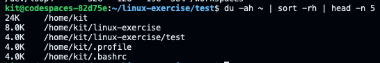

# Linux Exercise – Proof of Completion

**Student:** Luka Kit (`kit`)
**Environment:** GitHub Codespace (`codespaces-82d75e`)

---

## 1. Navigating the system

Commands used: `pwd`, `cd`, `cd ..`, `ls`, `mkdir linux-exercise`, `cd linux-exercise/`

---

## 2. Working with files and directories

Commands used: `touch description.txt`, `mkdir test`, `mv description.txt test/`, `ls`, `cd test/`

---

## 3. Moving and copying

Commands used: `mv description.txt my_profile.txt` (rename), `cp my_profile.txt ~/` (copy to home directory)

---

## 4. Permissions and Sizes

Commands used: `du -sh` (size of the current directory), `chmod 444 my_profile.txt` (read-only for everyone)

---

## 5. View System Information

Commands used: `whoami` (username: `kit`), `du -sh ~` (home directory: 24K), `df -h` (available disk space)

---

## 6. Extra task

Command used: `du -ah ~ | sort -rh | head -n 5`, which lists the 5 largest files and directories in the home directory

