# Introduction to Kali Linux – Proof of Completion

**Student:** Luka Kit
**Machine:** HP ZBook Power G7 (`luka-zbook`), Kali GNU/Linux Rolling installed directly on the laptop

---

## 1. Kali Linux graphical environment

### Operating system settings

I found the system settings under Applications → Settings → **Settings Manager**. Here we can find all the basic settings like we would on a Windows or a Mac computer

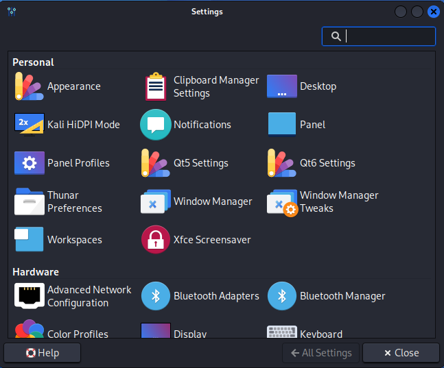

### File system

I used the Thunar file manager to go through my home folder. In it, I sorted the files by tapping the headers.

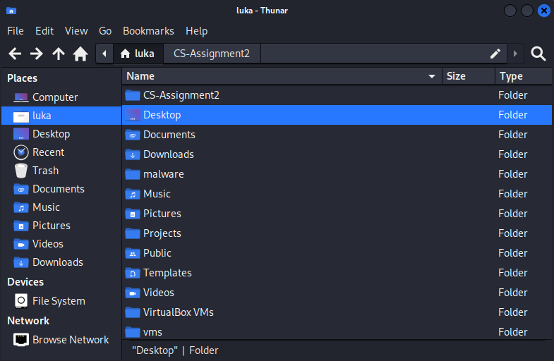

### 5 security tools from the menu

1. **Nmap** – scans a network and shows which devices are online and which ports are open
2. **Wireshark** – captures network traffic so you can look at the individual packets
3. **John the Ripper** – cracks passwords from hashes
4. **Burp Suite** – for testing websites; it sits between the browser and the site and intercepts the requests
5. **Metasploit** – a framework for exploiting known vulnerabilities

---

## 2. Basic command line commands

### whoami, hostnamectl, uname -a, df -h

- Logged-in user: `luka`
- Hostname: `luka-zbook`, OS: Kali GNU/Linux Rolling, kernel 7.1.5
- Main disk: 452G, with 410G still free

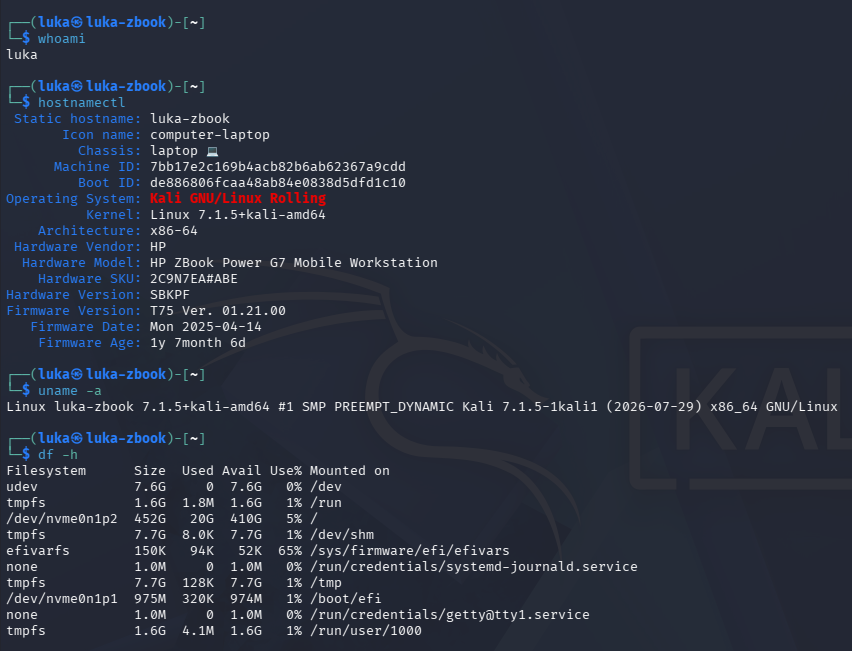

### ip a and wget

- The laptop has two network interfaces: `eth0` (192.168.1.126) and `wlan0` (192.168.1.173), plus the loopback `lo`
- `wget` downloaded `gists.txt` (9.4 KB) successfully

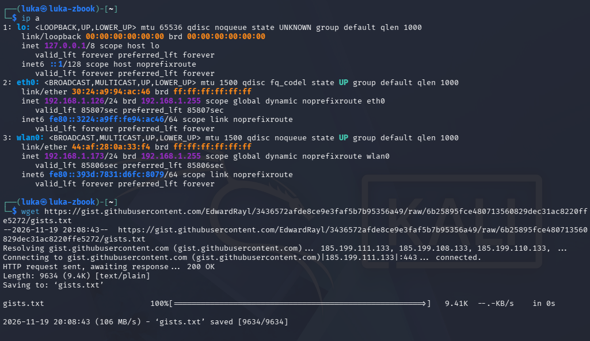

### sudo apt install 7zip

7zip was already installed, so apt upgraded it to version 26.05.

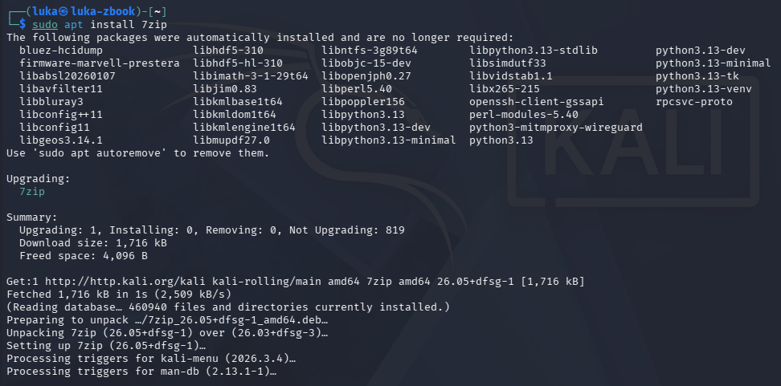

### htop

htop shows the CPU (12 cores), memory (2 GB of 15.4 GB used) and all running processes. 

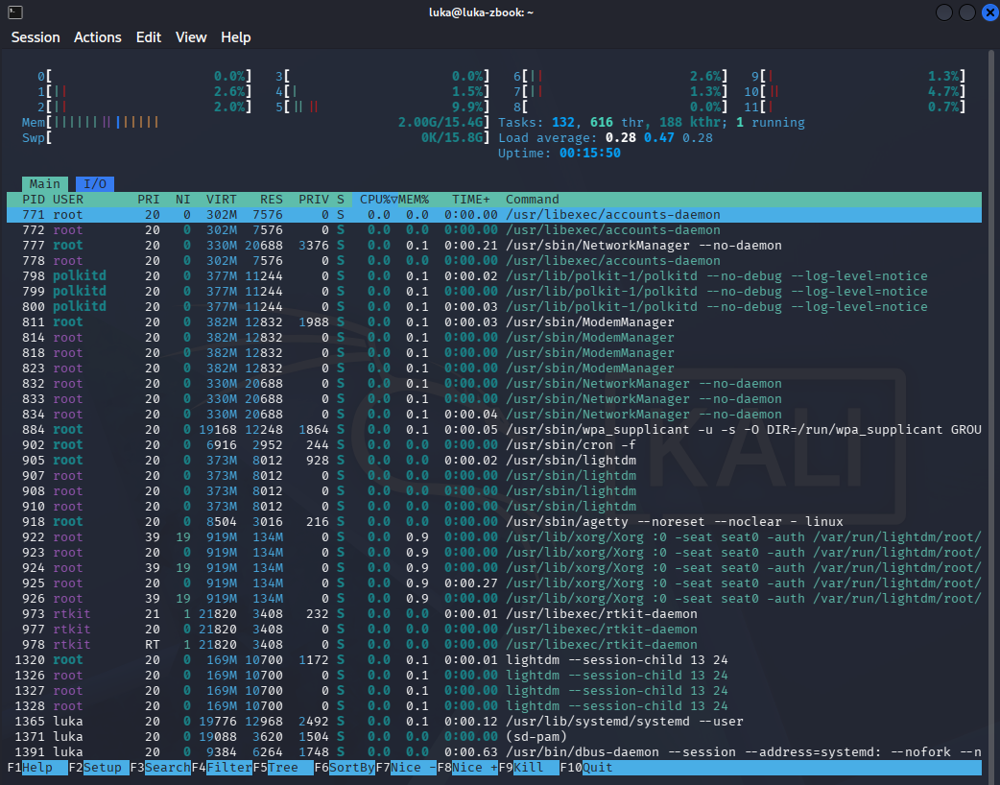

### traceroute google.com

The packets went from my router (192.168.1.254), through my ISP's (A1) network, and reached Google after 23 hops.

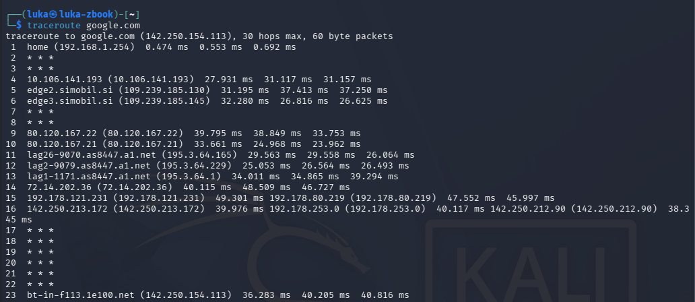

---

## 3. Using tools in Kali Linux

### speedtest-cli

apt couldn't find the package, so I installed it a different way and then it worked. It picked a server in Rome and measured 1.15 Mbit/s download and 0.40 Mbit/s upload. That is far slower than my connection really is, so the server it chose was probably a bad one.

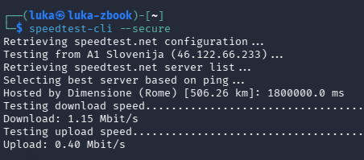

### tcpdump

The capture caught 10 packets on `eth0`. Most of them were DNS lookups to my router, plus some SSDP (UPnP) traffic from other devices on my network.

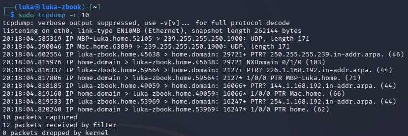

### nmap – OS detection (`-O`)

I scanned my own home router (192.168.1.254). Nmap found that it's a Zyxel device with open ports 53 (DNS), 80 (HTTP), 443 (HTTPS), 5000 (UPnP), 49152 and 49153. Ports 22 (SSH) and 23 (Telnet) are filtered. Nmap couldn't find an exact OS match.

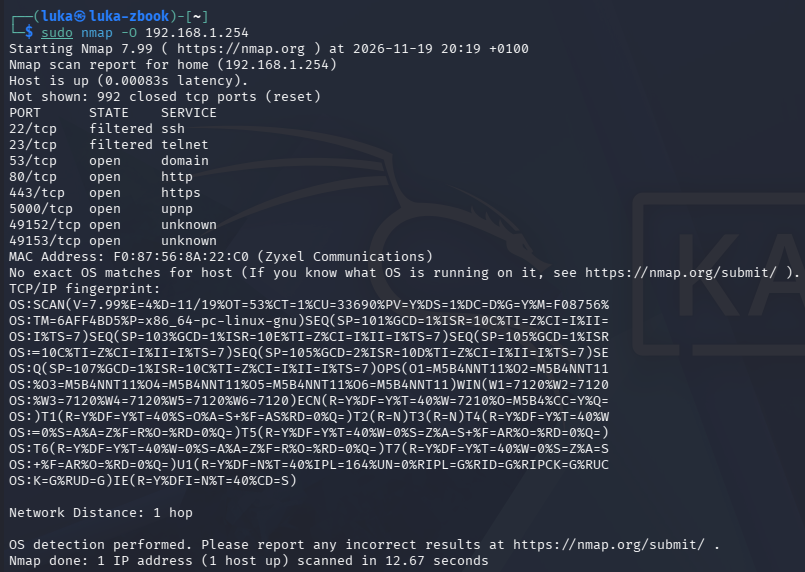

### nmap – stealth SYN scan (`-sS`)

Same router, but this time with a SYN scan. It gave the same results as the first scan.

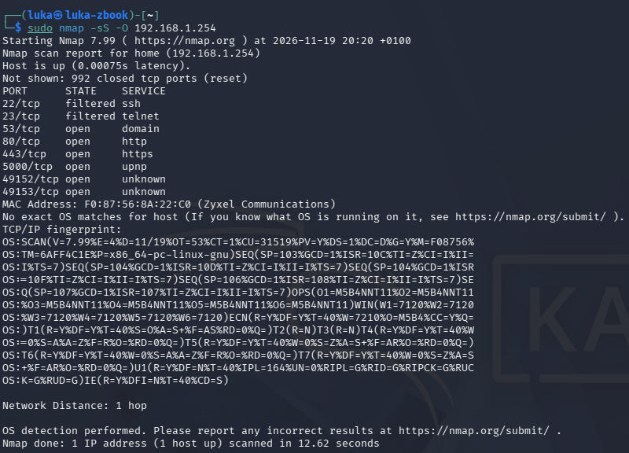

### nmap – all ports (`-p 1-65535`)

This scan checked all 65535 TCP ports in about 19 seconds. It didn't find any open ports beyond the ones above. 

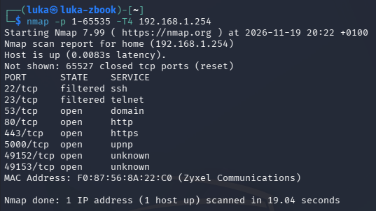

### searchsploit and dnsenum

- `searchsploit wordpress ftp` found 5 known exploits for the WordPress MiwoFTP 1.0.5 plugin (file download, CSRF, XSS)
- `dnsenum google.com` listed Google's IP addresses, its 4 name servers (ns1–ns4) and its mail servers

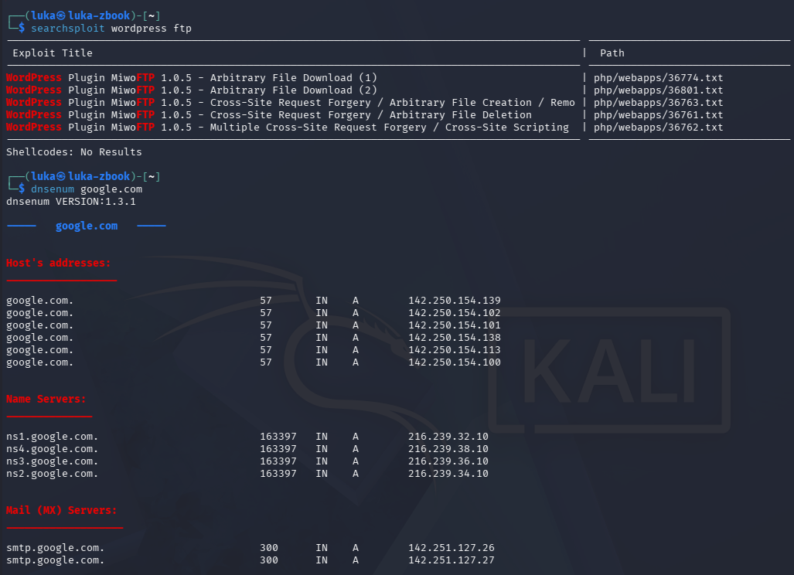

### lbd (Load Balancing Detector)

lbd found that google.com uses load balancing, through DNS (6 different IP addresses) and HTTP (the response headers differ between requests).

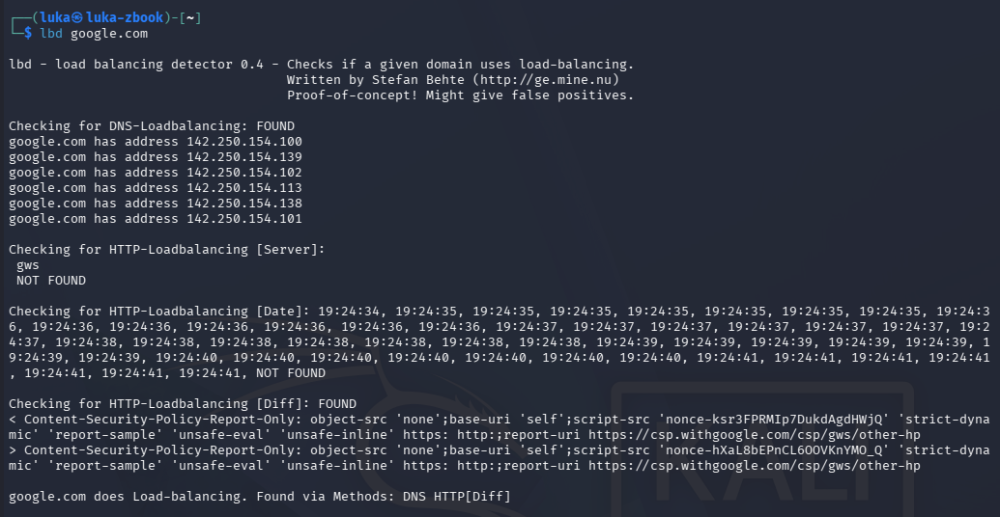

### Name-That-Hash

For the hash `ef487f75307f96954d3bb132e5f4b035`, the most likely type is **MD5**, followed by MD4 and NTLM.

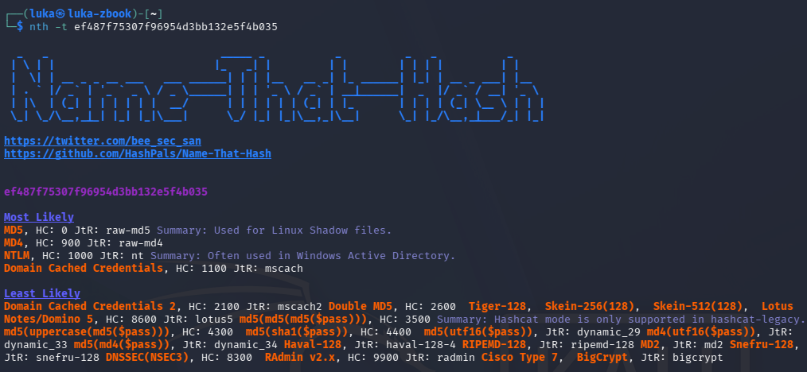

---

## 4. Reflection and Analysis

**Why do we use Kali Linux? What is the advantage of Kali Linux compared to other Linux distributions?**

We use Kali because it's made for security testing. It already has hundreds of tools installed, so you don't have to look for them and install them one by one, like you would on Ubuntu or another normal distro. Everything is sorted into categories in the menu, so it's easy to find what you need. But as one of our professors already mentioned to me, it's not meant as an everyday OS, because it's lacking a lot of defense. 

**Which features and tools of Kali Linux attracted you the most?**

I liked nmap the most. It was interesting to scan my own router and see which ports are open. I didn't expect it to have so many open ports, and it made me think about whether I really need all of them. I also liked tcpdump, because you can see what's happening on your network in real time, for example all the DNS requests the devices are sending. I find that I'm more interested in tools that check for defensive settings and not that much into regular pen testing. 

---
