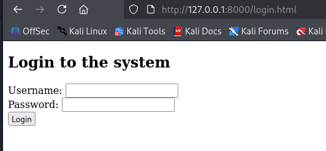
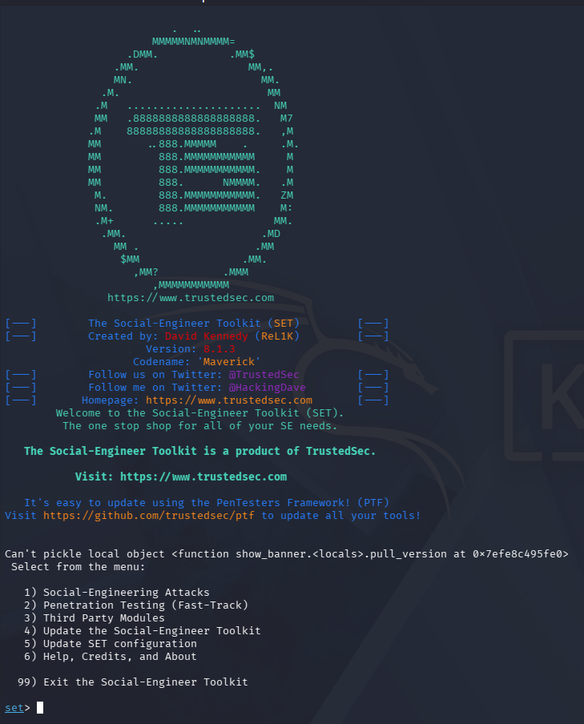
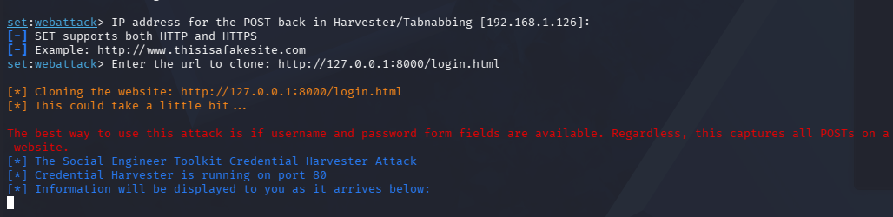
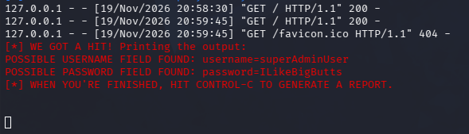

# Identifying and Preventing Phishing Attacks – Report

**Student:** Luka Kit
**Machine:** HP ZBook Power G7 (`luka-zbook`), Kali GNU/Linux Rolling

---

## 1. What I did

I built a simple `login.html` form with a username and password field, served it locally, and used the Social-Engineering Toolkit (SET) to clone it and run a credential harvester. Then I logged in to see the attack capture it.

## 2. Preparing the test form

I created `login.html` and served it on my own machine with a small web server so SET could copy it:

```bash
cd ~
python3 -m http.server 8000
```

This is the rendered login page in the browser:



I have to serve the .html page, because for some reason the file:/// kept failing and it wouldn't clone it for the attack.

## 3. Launching SET

I started SET with `sudo setoolkit` and went through the menus:

```
1) Social-Engineering Attacks
2) Website Attack Vectors
3) Credential Harvester Attack Method
2) Site Cloner
```



## 4. Cloning the site and starting the harvester

- IP address for the POST back: `192.168.1.126` (my laptop's eth0 address)
- URL to clone: `http://127.0.0.1:8000/login.html`

SET cloned the page and started the Credential Harvester on port 80, then waited for someone to submit the form.



## 5. Capturing the data

I opened the fake page and submitted test credentials. SET printed the captured username and password in plain text, with `[*] WE GOT A HIT!`. 



---

## 6. Reflection and Analysis

**What are the characteristics of phishing pages?**

Phishing pages are built to look like the real login of a service while quietly sending whatever you type to an attacker. We need to watch out for the following:

- The address might be an IP, a misspelled domain or the real brand name as a subdomain but the main domain being something weird.
- Many fake pages run on `http`, so the browser shows no padlock, or a warning.
- The link usually reaches you by email, SMS or a message, often with with some words that tell us it's urgent or money related
- An outdated logo, odd spelling or grammar, even though this is becoming less and less apparent, because of AI.

**How would you protect yourself from such an attack?**

- We need to check the address bar before typing a password, and make sure the domain is the right one.
- Don't click links we received in an email, especially if it's unexpected or out of the ordinary.
- Using MFA.
- Using a password manager, because it's linked to correct domains.

**Why do modern sites make such attacks harder?**

- Certificates are in all legit pages, so a fake `http` page stands out, and browsers flag insecure logins.
- Some pages force MFA, meaning that even if the password is stolen, the attacker still needs the second factor, which they usually don't have.
- Signing in from a new device or an unusual location often triggers an email alert or an extra verification step.

---
