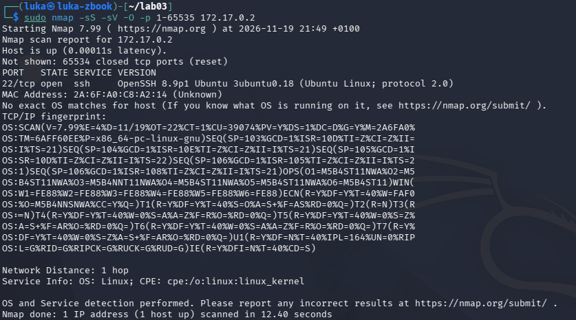
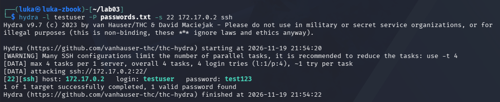

# Testing SSH Security with Nmap and Hydra (lab03) – Report

**Student:** Luka Kit
**Machine:** HP ZBook Power G7 (`luka-zbook`), Kali GNU/Linux Rolling

---

## 1. What I did

I set up a vulnerable SSH server in a Docker container, used `nmap` to find its
open ports and service version, then used `hydra` to brute-force the SSH password
with a small wordlist. The point is to show how an attacker finds a service and
why weak passwords and unnecessary open ports are dangerous.

## 2. Setup

I built the image from the `dvws/Dockerfile` and ran it with the container's SSH
mapped to port 2222 on my host:

```bash
docker build -t dvws ./dvws
sudo docker run -d -p 2222:22 --name dvws-ssh dvws
sudo docker inspect dvws-ssh | grep IPAddress   # -> 172.17.0.2
```

## 3. Step 1 – Nmap scan

```bash
sudo nmap -sS -sV -O -p 1-65535 172.17.0.2
```



What I found:
- **Open port:** `22/tcp` — the only open port; the other 65534 are closed
- **Service:** `OpenSSH 8.9p1 Ubuntu 3ubuntu0.18` (Ubuntu Linux, SSH protocol 2.0)
- **OS:** no exact match, but the service info identifies it as **Linux**

The fact that only port 22 is open is a good sign in itself — there's no extra
attack surface here — but SSH alone is enough if the password is weak, which is
what the next step shows.

## 4. Step 2 – Verify the SSH connection

```bash
ssh testuser@172.17.0.2 -p 22
```

Logged in with `test123` to confirm the service works, then logged out.

## 5. Step 3 – Password list

```bash
echo -e "password\n123456\ntest123\nadmin" > passwords.txt
```

## 6. Step 4 – Hydra brute-force

```bash
hydra -l testuser -P passwords.txt -s 22 172.17.0.2 ssh
```



Result: Hydra tried the four passwords (4 login tries) and found the right one

```
[22][ssh] host: 172.17.0.2   login: testuser   password: test123
```

`1 valid password found` — 

## 7. Short comment

**Why weak passwords are dangerous:** a password like `test123` is in every common
wordlist, so a tool like Hydra guesses it in seconds without doing anything
clever. Attackers automate this, trying thousands of passwords against any
server they can reach, and people often reuse the same weak password on several
accounts, so one lucky guess can open more than one door.

**Why close unused ports:** every open port is a something that an attacker can try to exploit. Here only port 22 was open, which is already fairly tight —
but anything you don't use should be closed so there's less attack surface to
worry about.

---

## 8. Reflection and analysis

**How would you protect the SSH server from brute-force attacks?**

The biggest thing would be to switch off password login and use SSH keys instead, so
there's no password to guess. On top of that I'd disable root login over SSH and
blocks an IP after a few failed attempts, so an
attacker can't just keep trying new passwords.

**What additional measures would you recommend?**

- Using SSH keys instead of passwords, which makes brute-force
  basically pointless
- Rate limiting to lock out an address after a handful of wrong
  tries
- Firewall settings that only lets trusted IPs reach the SSH port
- MFA for an extra step beyond the password

**How does the result change if we use a very strong password?**

With a strong password Hydra doesn't find it, because
it's not in the wordlist. To crack a long, random password you'd need a huge
wordlist or a full brute-force, which would take an unrealistic amount of time —
so in practice the attack fails

---
