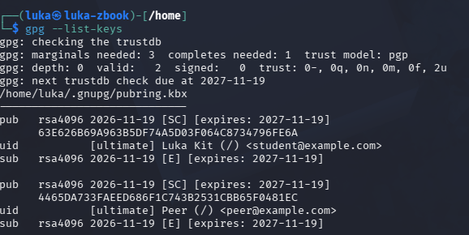
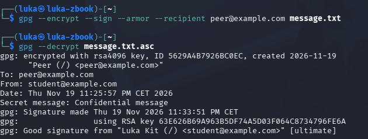

# GPG: Key Generation, Encryption, and Signing (lab04) – Report

**Student:** Luka Kit
**Machine:** HP ZBook Power G7 (`luka-zbook`), Kali GNU/Linux Rolling

---

## 1. What I did

I used GPG to generate a key pair, create a second peer identity to encrypt
to, then encrypted and signed a message and decrypted it back while verifying the
signature.

## 2. Generate the keys

```bash
gpg --full-generate-key
gpg --list-keys
```



Both keys were created with a `pub` primary key and a `sub` encryption subkey:

- `student@example.com` — fingerprint `63E6 26B9 A963 B5DF 74A5 D03F 064C 8734 796F E6A`
- `peer@example.com` — fingerprint `4465 DA73 3FAE ED68 6F1C 743B 2531 CBB6 5F04 81EC`

## 3. Export the public key

```bash
gpg --armor --export student@example.com > student_pubkey.asc
```

This is the key I would hand out so other people can encrypt to me or verify my
signatures.

## 4. Prepare the message

```bash
echo "To: peer@example.com
From: student@example.com
Date: $(date)
Secret message: Confidential message" > message.txt
```

## 5. Encrypt and sign

```bash
gpg --encrypt --sign --armor --recipient peer@example.com message.txt
```

This produced `message.txt.asc` — encrypted to the peer's public key and signed
with my own key.

## 6. Decrypt and verify

```bash
gpg --decrypt message.txt.asc
```



The output shows the message was decrypted with the peer's key and the signature
checked out:

```
gpg: encrypted with rsa4096 key ... "Peer (/) <peer@example.com>"
...
gpg: Good signature from "Luka Kit (/) <student@example.com>" [ultimate]
```

So both things worked: only the peer's private key could open it, and the `Good
signature` line proves it really came from me and wasn't changed.

---

## 7. Short answers

**1. Difference between encryption and signing**

Encryption hides the content of the message to make it unreadable. When we sing the message we're only proving that we're the ones who wrote it, but the content is visible.

**2. Role of the public and private key**

The public key is the one you give out to everyone. People use it to encrypt
messages to you, or to check your signature. The private key stays secret with
you, and you use it to decrypt messages sent to you and to sign things. 

**3. What happens when an encrypted file is modified**

We would be unable to read the file and the signature would fail.

---

## 8. Additional tasks (optional)

```bash
gpg --gen-revoke student@example.com > revoke.asc   # revocation certificate
gpg --clearsign message.txt                         # sign only, readable text
gpg --verify message.txt.asc                         # verify a signature
```

- A **revocation certificate** lets me cancel the key later if the private key is
  lost or stolen.
- **Clearsign** wraps a readable message in a signature without encrypting it —
  useful when you only need to prove authorship, not secrecy.

---
