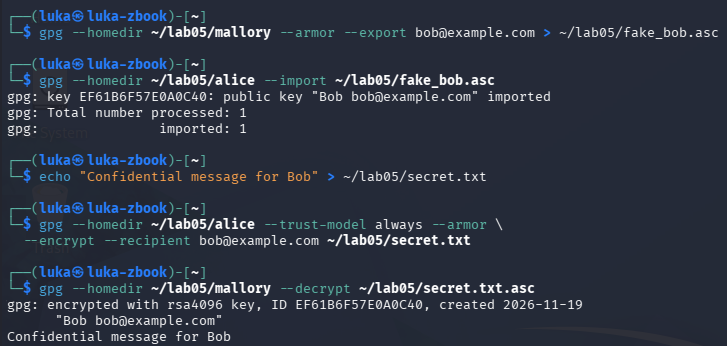
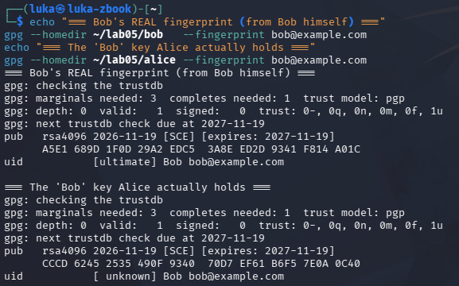

# Identifying MITM Attacks on GPG Keys / Web of Trust (lab05) – Report

**Student:** Luka Kit
**Machine:** HP ZBook Power G7 (`luka-zbook`), Kali GNU/Linux Rolling

---

## 1. What I did

I simulated a Man-in-the-Middle attack on GPG key exchange: the attacker
(Mallory) gives Alice a forged key that claims to be Bob's, Alice encrypts a
secret to Bob that Mallory can then read, and finally the attack is detected by
comparing fingerprints.

To make the attack real rather than just symbolic, I gave each person their own
keyring and had Mallory generate a key carrying Bob's name and email — so from
Alice's side it looks exactly like Bob's key. The only thing that distinguishes
them is the fingerprint, which is the whole point of the exercise.

## 2. Setup — three keyrings, three keys

```bash
mkdir -p ~/lab05/alice ~/lab05/bob ~/lab05/mallory
chmod 700 ~/lab05/alice ~/lab05/bob ~/lab05/mallory

gpg --homedir ~/lab05/alice   ... --quick-generate-key "Alice <alice@example.com>" rsa4096 sign,encr 1y
gpg --homedir ~/lab05/bob     ... --quick-generate-key "Bob <bob@example.com>"     rsa4096 sign,encr 1y  # real Bob
gpg --homedir ~/lab05/mallory ... --quick-generate-key "Bob <bob@example.com>"     rsa4096 sign,encr 1y  # forged
```

## 3. The MITM attack

Mallory exports his forged "Bob" key and Alice imports it, believing it is Bob's:

```bash
gpg --homedir ~/lab05/mallory --armor --export bob@example.com > ~/lab05/fake_bob.asc
gpg --homedir ~/lab05/alice --import ~/lab05/fake_bob.asc
```

Alice encrypts a confidential message "to Bob" — but it is really encrypted to
Mallory's key:

```bash
echo "Confidential message for Bob" > ~/lab05/secret.txt
gpg --homedir ~/lab05/alice --trust-model always --armor \
  --encrypt --recipient bob@example.com ~/lab05/secret.txt
```

Mallory decrypts it:

```bash
gpg --homedir ~/lab05/mallory --decrypt ~/lab05/secret.txt.asc
```



The message `Confidential message for Bob` comes out in plaintext on Mallory's
side.

## 4. Detection by fingerprint

Alice compares both keys and checks the fingerprints:

```bash
gpg --homedir ~/lab05/bob   --fingerprint bob@example.com   # real
gpg --homedir ~/lab05/alice --fingerprint bob@example.com   # what Alice has
```



The fingerprints do not match:

```text
Bob's real key:        A5E1 689D 1F0D 29A2 EDC5  3A8E ED2D 9341 F814 A01C
The 'Bob' Alice holds: CCCD 6245 2535 490F 9340  70D7 EF61 B6F5 7E0A 0C40
```

The key Alice holds ends in `7E0A 0C40` — the same ID Mallory's key showed when
he decrypted the message, confirming Alice was given Mallory's key.

---

## 5. Reflection

**1. Why doesn't GPG detect MITM attacks automatically?**

Because GPG only checks whether a key can decrypt or verify something — it has no
way of knowing who a key really belongs to. A public key is just data, and
anyone can put any name and email on one. 

**2. What is a fingerprint and why is it important?**

A fingerprint is a short hash of the full public key, and it's unique to that key.
Two keys can carry the exact same name and email but
their fingerprints will differ. It's the one reliable way to tell keys apart.

**3. Why is email not a secure channel for exchanging keys?**

Because email can be intercepted or spoofed. An attacker sitting in the middle can
swap the attached key for their own, and the recipient has no way to notice.

**4. How does the Web of Trust reduce the risk of MITM attacks?**

Instead of trusting a key blindly, people verify each other's fingerprints in
person and then sign each other's keys. If someone you already trust has verified
and signed the real key, you can trust it through them. 

---

## 6. Additional challenge — trust vs signed key vs ultimate trust

- Signed key: you've personally verified the key and
  signed it with your own key to vouch for it.
- Trust: how much you rely on that person to vouch for *other*
  people's keys — it controls how the Web of Trust propagates.
- Ultimate trust: reserved for your own keys — GPG trusts them completely
  because they're yours. 
